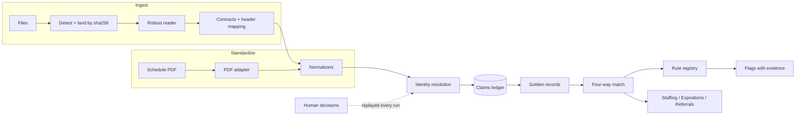

# Harborview Source of Truth

**Every number has receipts.**

Four messy files — an HR roster, a payroll export, a credential verification list, and a
printed weekly schedule PDF — go in. Out comes a reconciled picture of who works where,
who is paid for what, and who is permitted to do it, with every value traceable to the
exact cell or bounding box it came from.

The engine is industry-agnostic. Healthcare is a pluggable domain pack; a trucking pack
proves the same engine runs a different industry without changes to its core.

## Quick start

```bash
make setup     # venv + Python deps + npm install
make dev       # API on :8000, web app on http://localhost:5173
```

> Use `localhost`, not `127.0.0.1`: Vite 8 binds IPv6 localhost only.

```bash
make test          # test suite
make lint          # ruff + strict tsc
make samples       # regenerate the deterministic sample data
make demo          # ingest the messy sample set and write a report
make reset         # wipe the database, landed files, and reports
make help          # every target
```

## CLI

```bash
python -m sot ingest DIR --as-of 2026-09-21 --pack healthcare_ny [--type payroll.csv=payroll]
```

Writes `reports/<run_id>/` with flags, PBJ daily hours, expirations, referral readiness,
and a summary. It exits 0 even when the data is terrible — bad data is a finding, not a
crash. A non-zero exit means the engine itself broke.

## Architecture



Nothing is ever overwritten. Every source value is stored as a claim with its origin;
golden records are chosen per attribute by a configurable authority matrix, and the
losing claims stay queryable beside the winner.

## Layout

| Path | What's in it |
|---|---|
| `sot/` | The engine: ingest, normalize, resolve, ledger, match, rules, views, API |
| `packs/` | Domain packs: contracts, crosswalks, authority, rules, thresholds |
| `web/` | React + TypeScript front end |
| `scripts/` | Deterministic sample generators |
| `tests/` | Unit, integration, and the chaos deck |
| `var/`, `reports/` | Runtime output, gitignored |

## Documents

- [`SPEC.md`](SPEC.md) — the brief this was built against
- [`PLAN.md`](PLAN.md) — phases, risks, and the decisions taken up front
- [`PROGRESS.md`](PROGRESS.md) — what is built, what is next
- [`DECISIONS.md`](DECISIONS.md) — the design decisions and why
